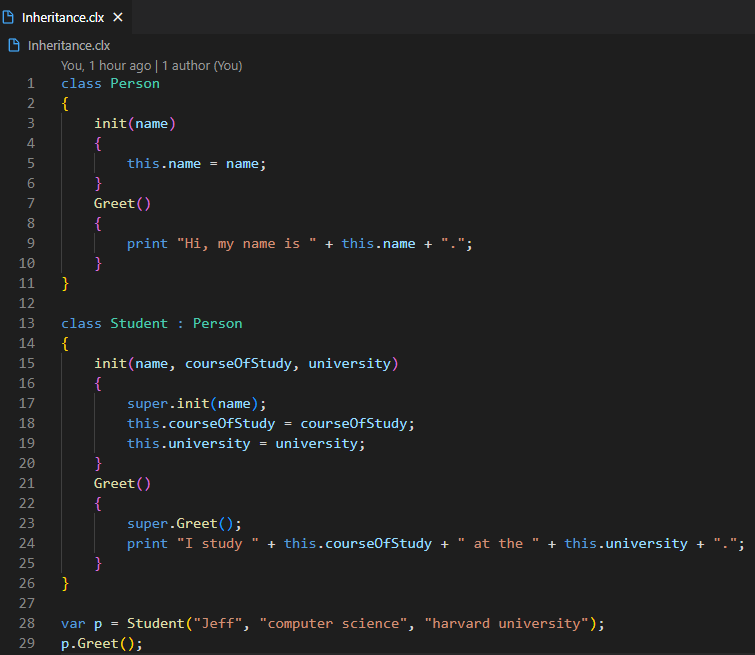

# vscode-cellox

[](https://github.com/FrederikTobner/vscode-cellox/actions/workflows/build.yml)

[Cellox](https://github.com/FrederikTobner/Cellox) support for Visual Studio Code



## Features

* syntax highlighting
* code snippets for the common language constructs

## Local installation

The extension is not published, install it from source.
[Node.js](https://nodejs.org/) and the `code` command of VS Code have to be available in the `PATH`:

```sh
npm run install-local
```

This packages the extension to `vscode-cellox.vsix` (using [vsce](https://github.com/microsoft/vscode-vsce)) and installs it. Reload VS Code afterwards. `npm run package` only creates the `.vsix` file, that can also be installed through *Extensions: Install from VSIX...*.

To try out changes without installing, open the folder in VS Code and press `F5` to start an Extension Development Host.
